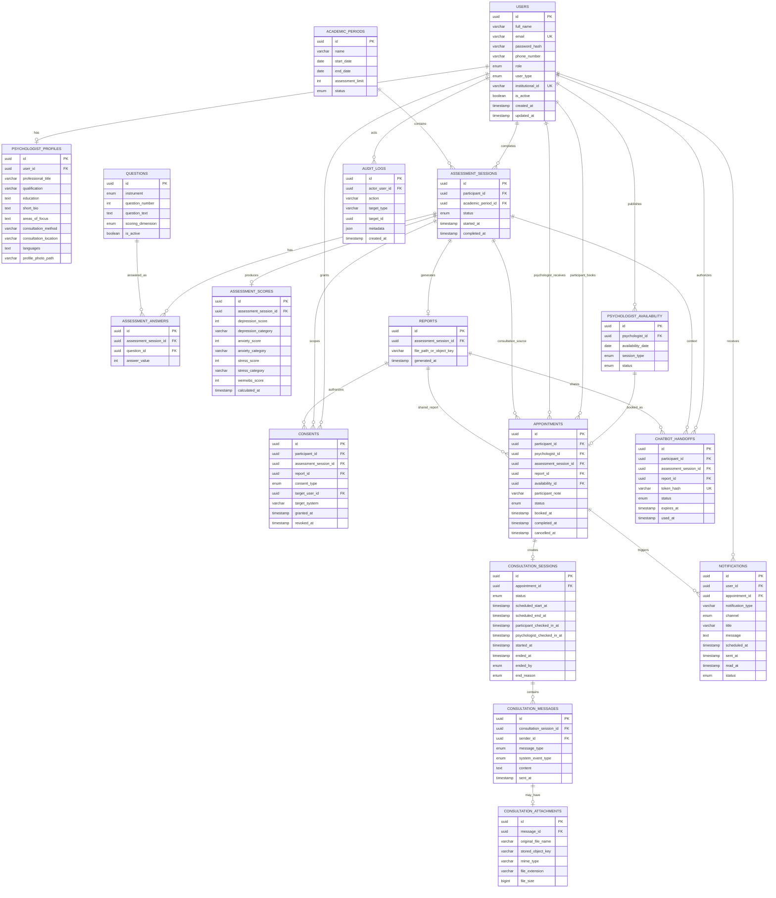

# ERD Specification — Coding Agent
## Mental Well-Being Assessment Platform

**Document Type:** Coding-Agent Data Model / ERD Specification  
**Audience:** Codex, Claude Code / Opus, Gemini, database/schema agents  
**Status:** Synchronized with current Business Rules, Functional Requirements, Non-Functional Requirements, and Use Cases

---

# 0. Agent Instructions

The coding agent MUST:

1. Treat this document as the authoritative logical data-model specification.
2. Preserve all PK/FK relationships, uniqueness semantics, ownership rules, and privacy boundaries.
3. Use database constraints where practical for structural invariants.
4. Use application/service-layer validation for cross-entity business rules that cannot be safely expressed with simple constraints.
5. Avoid speculative tables/columns unless required by approved requirements.
6. Keep the model simple enough for Capstone scope.
7. Prefer normalized relationships over duplicated sensitive data.
8. Do not expose internal IDs as authorization by themselves.

---

# 1. Entity Overview

Core entities:

```text
users
psychologist_profiles
academic_periods
questions
assessment_sessions
assessment_answers
assessment_scores
reports
consents
psychologist_availability
appointments
consultation_sessions
consultation_messages
consultation_attachments
chatbot_handoffs
notifications
audit_logs
```

---

# 2. Relationship Overview

```text
users
 ├── 0..1 psychologist_profiles
 ├── 0..* assessment_sessions
 ├── 0..* appointments as participant
 ├── 0..* appointments as psychologist
 ├── 0..* psychologist_availability
 ├── 0..* consents
 ├── 0..* notifications
 └── 0..* audit_logs

academic_periods
 └── 1..* assessment_sessions

assessment_sessions
 ├── 1..* assessment_answers
 ├── 0..1 assessment_scores
 ├── 0..1 reports
 ├── 0..* consents
 ├── 0..* appointments
 └── 0..* chatbot_handoffs

questions
 └── 1..* assessment_answers

reports
 ├── 0..* consents
 ├── 0..* appointments
 └── 0..* chatbot_handoffs

psychologist_availability
 └── 0..* historical appointments, at most one active appointment per slot

appointments
 └── 0..1 consultation_sessions
 ├── 0..* appointment-linked consent grants over history
 └── 0..1 replacement appointment through rescheduled_from_appointment_id

consultation_sessions
 └── 0..* consultation_messages

consultation_messages
 └── 0..1 consultation_attachments
```

---

# 3. Entity: users

## Purpose
Stores authentication and core identity for all platform users.

## Columns

```text
id                  UUID / PK
full_name           VARCHAR / NOT NULL
email               VARCHAR / NOT NULL / UNIQUE
password_hash       VARCHAR / NOT NULL
phone_number        VARCHAR / NOT NULL
role                ENUM / NOT NULL
user_type           ENUM / NULL
institutional_id    VARCHAR / NULL / UNIQUE
is_active           BOOLEAN / NOT NULL / DEFAULT TRUE
created_at          TIMESTAMP / NOT NULL
updated_at          TIMESTAMP / NOT NULL
```

## Enum: role

```text
PARTICIPANT
PSYCHOLOGIST
SUPERADMIN
```

## Enum: user_type

```text
STUDENT
LECTURER
```

## Rules

- `user_type` is required when `role = PARTICIPANT`.
- `institutional_id` is required when `role = PARTICIPANT`.
- `institutional_id` represents NIM for STUDENT and NIP for LECTURER.
- `user_type` and `institutional_id` SHOULD be NULL for psychologist/superadmin unless approved otherwise.
- `email` MUST be unique.
- `institutional_id` MUST be unique when present.
- plaintext password MUST NOT be stored.

---

# 4. Entity: psychologist_profiles

## Purpose
Stores professional/public psychologist information separately from authentication data.

**Implementation status (Phase 3 B1, 28 October 2026):** the additive table is implemented. `areas_of_focus` and `languages` are PostgreSQL `TEXT[]` columns. `profile_photo_path` remains a future field and is not part of the current Prisma model or migration.

## Columns

```text
id                      UUID / PK
user_id                 UUID / FK users.id / UNIQUE / NOT NULL
professional_title      VARCHAR / NULL
qualification           VARCHAR / NULL
education               TEXT / NULL
short_bio               TEXT / NULL
areas_of_focus          TEXT[] / DEFAULT []
consultation_method     VARCHAR or ENUM / NULL
consultation_location   VARCHAR / NULL
languages               TEXT[] / DEFAULT []
created_at              TIMESTAMP / NOT NULL
updated_at              TIMESTAMP / NOT NULL
```

Database check constraint MUST require `appointment_id IS NOT NULL` for `APPOINTMENT_REPORT_ACCESS` and `appointment_id IS NULL` for `STANDALONE_REPORT_ACCESS` and other non-appointment consent types.

## Relationship

```text
users 1 ----- 0..1 psychologist_profiles
```

## Rules

- `user_id` MUST reference a user with `role = PSYCHOLOGIST`.
- profile data is participant-facing professional information.
- sensitive admin-only metadata SHOULD NOT be mixed into this entity.

---

# 5. Entity: academic_periods

## Purpose
Represents semester/academic-period boundaries and assessment quota configuration.

## Columns

```text
id                  UUID / PK
name                VARCHAR / NOT NULL
start_date          DATE / NOT NULL
end_date            DATE / NOT NULL
assessment_limit    INTEGER / NOT NULL / DEFAULT 3
status              ENUM / NOT NULL
created_at          TIMESTAMP / NOT NULL
updated_at          TIMESTAMP / NOT NULL
```

## Enum: status

```text
ACTIVE
INACTIVE
```

## Rules

- Current business default: `assessment_limit = 3`.
- Application MUST be able to resolve the active period.
- Previous-period completed assessments MUST NOT affect new-period quota.
- Prefer at most one ACTIVE academic period at a time unless future policy explicitly allows overlap.

---

# 6. Entity: questions

## Purpose
Master question bank for DASS-21 and WEMWBS.

## Columns

```text
id                  UUID / PK
instrument          ENUM / NOT NULL
question_number     INTEGER / NOT NULL
question_text       TEXT / NOT NULL
scoring_dimension   ENUM / NOT NULL
is_active           BOOLEAN / NOT NULL / DEFAULT TRUE
created_at          TIMESTAMP / NOT NULL
updated_at          TIMESTAMP / NOT NULL
```

## Enum: instrument

```text
DASS21
WEMWBS
```

## Enum: scoring_dimension

```text
DEPRESSION
ANXIETY
STRESS
WELLBEING
```

## Recommended Constraint

```text
UNIQUE(instrument, question_number)
```

---

# 7. Entity: assessment_sessions

## Purpose
Represents one complete Mental Well-Being Assessment session containing both DASS-21 and WEMWBS.

## Columns

```text
id                  UUID / PK
participant_id      UUID / FK users.id / NOT NULL
academic_period_id  UUID / FK academic_periods.id / NOT NULL
status              ENUM / NOT NULL
started_at          TIMESTAMP / NOT NULL
completed_at        TIMESTAMP / NULL
created_at          TIMESTAMP / NOT NULL
updated_at          TIMESTAMP / NOT NULL
```

## Enum: status

```text
IN_PROGRESS
COMPLETED
```

## Relationships

```text
users 1 ----- 0..* assessment_sessions
academic_periods 1 ----- 0..* assessment_sessions
```

## Rules

- `participant_id` MUST reference `role = PARTICIPANT`.
- DASS-21 and WEMWBS MUST share this one session.
- quota count MUST use only rows where `status = COMPLETED`.
- duplicate completion MUST be prevented/idempotent.
- assessment quota MUST be checked by `(participant_id, academic_period_id)`.

---

# 8. Entity: assessment_answers

## Purpose
Stores one participant answer per assessment question.

## Columns

```text
id                      UUID / PK
assessment_session_id   UUID / FK assessment_sessions.id / NOT NULL
question_id             UUID / FK questions.id / NOT NULL
answer_value            INTEGER or approved scalar / NOT NULL
created_at              TIMESTAMP / NOT NULL
updated_at              TIMESTAMP / NOT NULL
```

## Required Constraint

```text
UNIQUE(assessment_session_id, question_id)
```

## Rules

- answer must belong to a question that is part of the approved instrument.
- answers MUST NOT be used directly by external chatbot unless future approved requirement says otherwise.

---

# 9. Entity: assessment_scores

## Purpose
Stores finalized deterministic score output for one completed assessment session.

## Columns

```text
id                      UUID / PK
assessment_session_id   UUID / FK assessment_sessions.id / UNIQUE / NOT NULL
depression_score        INTEGER / NOT NULL
depression_category     VARCHAR or ENUM / NOT NULL
anxiety_score           INTEGER / NOT NULL
anxiety_category        VARCHAR or ENUM / NOT NULL
stress_score            INTEGER / NOT NULL
stress_category         VARCHAR or ENUM / NOT NULL
wemwbs_score            INTEGER / NOT NULL
calculated_at           TIMESTAMP / NOT NULL
created_at              TIMESTAMP / NOT NULL
updated_at              TIMESTAMP / NOT NULL
```

## Relationship

```text
assessment_sessions 1 ----- 0..1 assessment_scores
```

## Rules

- exactly one official score set per completed assessment.
- no universal combined mental-health score.
- scores MUST be calculated by trusted deterministic backend logic.

---

# 10. Entity: reports

## Purpose
Represents the generated official assessment report.

## Columns

```text
id                      UUID / PK
assessment_session_id   UUID / FK assessment_sessions.id / UNIQUE / NOT NULL
status                  ENUM PENDING | GENERATED / NOT NULL / DEFAULT PENDING
file_path_or_object_key VARCHAR / NULL
generated_at            TIMESTAMP / NULL
created_at              TIMESTAMP / NOT NULL
updated_at              TIMESTAMP / NOT NULL
```

## Relationship

```text
assessment_sessions 1 ----- 0..1 reports
```

## Rules

- report exists only for completed assessment.
- report is private by default.
- report file storage MUST NOT use unrestricted public URLs.
- `GENERATED` means the private report artifact was successfully generated and stored; assessment submission creates `PENDING` metadata only.

---

# 11. Entity: consents

## Purpose
Stores explicit participant authorization for protected sharing.

## Columns

```text
id                      UUID / PK
participant_id          UUID / FK users.id / NOT NULL
assessment_session_id   UUID / FK assessment_sessions.id / NOT NULL
report_id               UUID / FK reports.id / NOT NULL
target_user_id          UUID / FK users.id / NOT NULL
appointment_id          UUID / FK appointments.id / NULL
consent_type            ENUM APPOINTMENT_REPORT_ACCESS | STANDALONE_REPORT_ACCESS
purpose                 TEXT / NOT NULL
scope                   JSONB / NOT NULL
policy_version          VARCHAR / NOT NULL
granted_at              TIMESTAMPTZ / NOT NULL
expires_at              TIMESTAMPTZ / NULL
expired_at              TIMESTAMPTZ / NULL
revoked_at              TIMESTAMPTZ / NULL
created_at              TIMESTAMPTZ / NOT NULL
```

## Enum: consent_type

```text
APPOINTMENT_REPORT_ACCESS
STANDALONE_REPORT_ACCESS
```

## Rules

### Appointment report consent

```text
consent_type = APPOINTMENT_REPORT_ACCESS
participant_id, report_id, and target_user_id match the appointment
appointment_id IS NOT NULL and references that appointment
expires_at equals the appointment scheduled end at grant time
```

Booking consent is fresh, affirmative, and created in the booking transaction. A standalone grant cannot satisfy booking consent. Revocation removes authorization from that grant immediately but does not cancel the appointment or close consultation. Re-consent creates a new row; revoked/expired rows are never reactivated.

### Standalone report consent

```text
consent_type = STANDALONE_REPORT_ACCESS
participant_id, report_id, and target_user_id are independently validated
appointment_id IS NULL
expires_at IS NULL
```

Standalone grants remain active until revoked and are evaluated independently from appointment grants. They do not satisfy the booking prerequisite.

Appointment-linked report authorization expires at the earliest of revocation, psychologist early closure, scheduled end, authorized cancellation, or confirmed terminal no-show. The API also checks authoritative server time at each access; expiry does not depend on a delayed close job.

### ConsentAuditEvent

```text
actor_type      ENUM USER | SYSTEM / NOT NULL
actor_user_id   UUID / FK users.id / NULL
action          ENUM GRANTED | REVOKED | EXPIRED | ACCESSED / NOT NULL
occurred_at     TIMESTAMPTZ / NOT NULL
```

CHECK `USER` events have a user ID and `SYSTEM` events have none. The first API observation of an unmaterialized appointment-grant expiry sets `expired_at` to its effective lifecycle time and appends one `EXPIRED` event with server observation time. Access checks deny from current server time and lifecycle state independently of this audit write. Audit events remain append-only.

### Chatbot consent
For chatbot:

```text
target_system = EXTERNAL_CHATBOT
```

- consent MUST be participant-specific.
- consent MUST be report/assessment-specific.
- consent MUST NOT imply access to full assessment history.
- Consent audit events append grant, revoke, authorized access, and lifecycle-expiry actions with actor and server timestamp.
- Grant scope/purpose/version are immutable; revoke/expiry timestamps are one-way transitions and audit events are append-only.
- Chatbot and contact consent remain separate future workstreams and are not introduced by this migration.

---

# 12. Entity: psychologist_availability

## Purpose
Stores psychologist availability per date and fixed consultation session.

## Columns

```text
id                  UUID / PK
psychologist_id     UUID / FK users.id / NOT NULL
availability_date   DATE / NOT NULL
session_type        ENUM / NOT NULL
status              ENUM / NOT NULL
created_at          TIMESTAMP / NOT NULL
updated_at          TIMESTAMP / NOT NULL
```

## Enum: session_type

```text
MORNING
AFTERNOON
EVENING
```

## Fixed Session Mapping

```text
MORNING   = 09:00–11:00
AFTERNOON = 13:00–15:00
EVENING   = 16:00–18:00
```

## Enum: status

```text
AVAILABLE
BOOKED
UNAVAILABLE
```

## Required Constraint

```text
UNIQUE(psychologist_id, availability_date, session_type)
```

## Rules

- psychologist may make all/some/none sessions available per date.
- one psychologist/session/date MUST NOT be double-booked.
- participant reads MUST omit slots whose scheduled start has passed; past no-show slots MUST NOT be automatically reopened.
- BOOKED availability MUST only be released during an authorized transition and when the slot remains eligible for reuse.
- arbitrary time slots are out of scope.

---

# 13. Entity: appointments

## Purpose
Represents the confirmed relationship between participant, psychologist, current assessment report, and one fixed consultation session.

## Columns

```text
id                      UUID / PK
participant_id          UUID / FK users.id / NOT NULL
psychologist_id         UUID / FK users.id / NOT NULL
assessment_session_id   UUID / FK assessment_sessions.id / NOT NULL
report_id               UUID / FK reports.id / NOT NULL
availability_id         UUID / FK psychologist_availability.id / NOT NULL
rescheduled_from_appointment_id UUID / FK appointments.id / NULL
participant_note        VARCHAR(500) / NULL
status                  ENUM / NOT NULL
scheduled_start_at      TIMESTAMPTZ / NOT NULL
scheduled_end_at        TIMESTAMPTZ / NOT NULL
booked_at               TIMESTAMP / NOT NULL
completed_at            TIMESTAMP / NULL
cancelled_at            TIMESTAMP / NULL
created_at              TIMESTAMP / NOT NULL
updated_at              TIMESTAMP / NOT NULL
```

## Enum: status

```text
CONFIRMED
IN_PROGRESS
COMPLETED
CANCELLED
NO_SHOW
RESCHEDULED
```

## Required Constraint

```text
UNIQUE active appointment per availability_id (PostgreSQL partial unique index)
```

## Rules

Application MUST verify:

```text
assessment_session.participant_id == appointment.participant_id
report.assessment_session_id == appointment.assessment_session_id
availability.psychologist_id == appointment.psychologist_id
availability.status == AVAILABLE before booking
availability's scheduled start > authoritative server time
assessment_session is participant's latest completed combined assessment
report.assessment_session_id == appointment.assessment_session_id
report.status == GENERATED
appointment-linked consent matches appointment participant/report/psychologist and has appointment_id
```

Successful booking MUST atomically:

```text
create appointment CONFIRMED
mark availability BOOKED
create consultation_session
create APPOINTMENT_REPORT_ACCESS consent with appointment_id
```

Any failure rolls back the complete transaction. No second psychologist approval step. Historical appointments are retained; terminal history does not permanently block a valid future slot reuse.

---

# 14. Entity: consultation_sessions

## Purpose
Represents runtime consultation/chat state for one appointment.

## Columns

```text
id                          UUID / PK
appointment_id              UUID / FK appointments.id / UNIQUE / NOT NULL
status                      ENUM / NOT NULL
scheduled_start_at          TIMESTAMP / NOT NULL
scheduled_end_at            TIMESTAMP / NOT NULL
participant_checked_in_at   TIMESTAMP / NULL
psychologist_checked_in_at  TIMESTAMP / NULL
started_at                  TIMESTAMP / NULL
ended_at                    TIMESTAMP / NULL
ended_by                    ENUM / NULL
end_reason                  ENUM / NULL
created_at                  TIMESTAMP / NOT NULL
updated_at                  TIMESTAMP / NOT NULL
```

## Enum: status

```text
SCHEDULED
READY
IN_PROGRESS
PSYCHOLOGIST_LATE
PARTICIPANT_LATE
NO_SHOW
COMPLETED
CLOSED
```

## Enum: ended_by

```text
PSYCHOLOGIST
SYSTEM
```

## Enum: end_reason

```text
PSYCHOLOGIST_COMPLETED
SCHEDULED_END_REACHED
```

## Required Constraint

```text
UNIQUE(appointment_id)
```

## Rules

- participant MUST NOT close session.
- assigned psychologist MAY close early.
- system MUST auto-close at scheduled end.
- chat MUST NOT remain writable after `scheduled_end_at`.
- no follow-up session due to insufficient duration.

---

# 15. Entity: consultation_messages

## Purpose
Stores user and system messages for one human consultation session.

## Columns

```text
id                      UUID / PK
consultation_session_id UUID / FK consultation_sessions.id / NOT NULL
sender_id               UUID / FK users.id / NULL
message_type            ENUM / NOT NULL
system_event_type       ENUM / NULL
content                 TEXT / NULL
sent_at                 TIMESTAMP / NOT NULL
created_at              TIMESTAMP / NOT NULL
```

## Enum: message_type

```text
TEXT
SYSTEM
```

## Suggested Enum: system_event_type

```text
SESSION_STARTED
PSYCHOLOGIST_JOINED
PARTICIPANT_JOINED
SESSION_ENDING_SOON
PSYCHOLOGIST_LATE
SESSION_ENDED_BY_PSYCHOLOGIST
SESSION_AUTO_CLOSED
```

## Rules

- `sender_id` may be NULL for SYSTEM messages.
- authorized human senders:
  - appointment participant;
  - appointment psychologist.
- backend MUST reject message writes after session closure/end time.

---

# 16. Entity: consultation_attachments

## Purpose
Stores metadata for consultation image/PDF attachments.

## Columns

```text
id                  UUID / PK
message_id          UUID / FK consultation_messages.id / UNIQUE / NOT NULL
original_file_name  VARCHAR / NOT NULL
stored_object_key   VARCHAR / NOT NULL
mime_type           VARCHAR / NOT NULL
file_extension      VARCHAR / NOT NULL
file_size           BIGINT / NOT NULL
created_at          TIMESTAMP / NOT NULL
```

## Current Allowed Extensions

```text
.jpg
.jpeg
.png
.webp
.pdf
```

## Current Allowed MIME Types

```text
image/jpeg
image/png
image/webp
application/pdf
```

## Required Constraint

```text
UNIQUE(message_id)
```

This represents the current rule:

```text
max 1 attachment per message
```

## Rules

- private storage only.
- original filename MUST NOT be trusted as object/storage path.
- attachment upload only while consultation is writable.
- existing attachments may remain readable after closure.
- attachments MUST NOT be automatically included in chatbot handoff.
- image baseline max size = 5 MB.
- PDF baseline max size = 10 MB.

---

# 17. Entity: chatbot_handoffs

## Purpose
Provides secure scoped handoff from assessment website to external chatbot.

## Columns

```text
id                      UUID / PK
participant_id          UUID / FK users.id / NOT NULL
assessment_session_id   UUID / FK assessment_sessions.id / NOT NULL
report_id               UUID / FK reports.id / NOT NULL
token_hash              VARCHAR / NOT NULL / UNIQUE
status                  ENUM / NOT NULL
expires_at              TIMESTAMP / NOT NULL
used_at                 TIMESTAMP / NULL
created_at              TIMESTAMP / NOT NULL
updated_at              TIMESTAMP / NOT NULL
```

## Suggested Enum: status

```text
ACTIVE
USED
EXPIRED
REVOKED
```

## Rules

- token MUST be scoped to participant + report/assessment.
- raw assessment ID alone MUST NOT authorize access.
- consultation attachments MUST NOT be included automatically.
- chatbot should receive processed current-report context only.

---

# 18. Entity: notifications

## Purpose
Stores in-app/email notification lifecycle.

## Columns

```text
id                  UUID / PK
user_id             UUID / FK users.id / NOT NULL
appointment_id      UUID / FK appointments.id / NULL
notification_type   ENUM or VARCHAR / NOT NULL
channel             ENUM / NOT NULL
title               VARCHAR / NOT NULL
message             TEXT / NOT NULL
scheduled_at        TIMESTAMP / NULL
sent_at             TIMESTAMP / NULL
read_at             TIMESTAMP / NULL
status              ENUM / NOT NULL
created_at          TIMESTAMP / NOT NULL
updated_at          TIMESTAMP / NOT NULL
```

## Suggested notification_type

```text
APPOINTMENT_REMINDER_24H
APPOINTMENT_REMINDER_1H
APPOINTMENT_REMINDER_10M
PSYCHOLOGIST_LATE_REMINDER
```

## Suggested channel

```text
IN_APP
EMAIL
```

SMS/WhatsApp are out of scope unless separately approved.

---

# 19. Entity: audit_logs

## Purpose
Tracks operational/security-significant events without duplicating sensitive payloads.

## Columns

```text
id              UUID / PK
actor_user_id   UUID / FK users.id / NULL
action          VARCHAR / NOT NULL
target_type     VARCHAR / NOT NULL
target_id       UUID or VARCHAR / NULL
metadata        JSON / NULL
created_at      TIMESTAMP / NOT NULL
```

## Example actions

```text
ASSESSMENT_COMPLETED
REPORT_GENERATED
CONSENT_GRANTED
CHATBOT_HANDOFF_CREATED
APPOINTMENT_CREATED
PARTICIPANT_CHECKED_IN
PSYCHOLOGIST_CHECKED_IN
PSYCHOLOGIST_LATE
PSYCHOLOGIST_NO_SHOW
CONSULTATION_STARTED
CONSULTATION_ENDED_BY_PSYCHOLOGIST
CONSULTATION_AUTO_CLOSED
```

## Rules

MUST NOT store in generic audit logs:

```text
plaintext password
password hash
raw auth token
full assessment report
full consultation message content
attachment binary
```

---

# 20. Required Unique Constraints

The schema SHOULD enforce:

```text
UNIQUE(users.email)

UNIQUE(users.institutional_id)
  where institutional_id IS NOT NULL

UNIQUE(psychologist_profiles.user_id)

UNIQUE(questions.instrument, questions.question_number)

UNIQUE(assessment_answers.assessment_session_id, assessment_answers.question_id)

UNIQUE(assessment_scores.assessment_session_id)

UNIQUE(reports.assessment_session_id)

UNIQUE(psychologist_availability.psychologist_id,
       psychologist_availability.availability_date,
       psychologist_availability.session_type)

UNIQUE active appointments(availability_id) WHERE appointment status = CONFIRMED

UNIQUE(consultation_sessions.appointment_id)

UNIQUE(consultation_attachments.message_id)

UNIQUE(chatbot_handoffs.token_hash)
```

---

# 21. Required Foreign-Key Relationships

```text
psychologist_profiles.user_id
  -> users.id

assessment_sessions.participant_id
  -> users.id

assessment_sessions.academic_period_id
  -> academic_periods.id

assessment_answers.assessment_session_id
  -> assessment_sessions.id

assessment_answers.question_id
  -> questions.id

assessment_scores.assessment_session_id
  -> assessment_sessions.id

reports.assessment_session_id
  -> assessment_sessions.id

consents.participant_id
  -> users.id

consents.assessment_session_id
  -> assessment_sessions.id

consents.report_id
  -> reports.id

consents.target_user_id
  -> users.id

consents.appointment_id
  -> appointments.id (nullable only for non-appointment consent types)

psychologist_availability.psychologist_id
  -> users.id

appointments.participant_id
  -> users.id

appointments.psychologist_id
  -> users.id

appointments.assessment_session_id
  -> assessment_sessions.id

appointments.report_id
  -> reports.id

appointments.availability_id
  -> psychologist_availability.id

consultation_sessions.appointment_id
  -> appointments.id

consultation_messages.consultation_session_id
  -> consultation_sessions.id

consultation_messages.sender_id
  -> users.id

consultation_attachments.message_id
  -> consultation_messages.id

chatbot_handoffs.participant_id
  -> users.id

chatbot_handoffs.assessment_session_id
  -> assessment_sessions.id

chatbot_handoffs.report_id
  -> reports.id

notifications.user_id
  -> users.id

notifications.appointment_id
  -> appointments.id

audit_logs.actor_user_id
  -> users.id
```

---

# 22. Application-Level Cross-Entity Invariants

These MUST be checked by service/domain logic where DB constraints alone are insufficient.

## INV-DATA-001

```text
assessment_session.participant_id
==
appointment.participant_id
```

---

## INV-DATA-002

```text
report.assessment_session_id
==
appointment.assessment_session_id
```

---

## INV-DATA-003

```text
availability.psychologist_id
==
appointment.psychologist_id
```

---

## INV-DATA-004

Before booking:

```text
availability.status == AVAILABLE
```

After successful booking:

```text
availability.status == BOOKED
appointment.status == CONFIRMED
```

---

## INV-DATA-005

Psychologist report access requires:

```text
appointment.psychologist_id == caller.id
AND
valid PSYCHOLOGIST_REPORT_ACCESS consent
AND
consent.target_user_id == caller.id
AND
consent.report_id == appointment.report_id
```

---

## INV-DATA-006

Consultation message sender must satisfy:

```text
sender_id == appointment.participant_id
OR
sender_id == appointment.psychologist_id
```

---

## INV-DATA-007

Consultation session close authorization:

```text
participant -> DENY
assigned psychologist -> ALLOW manual early close
system -> ALLOW scheduled auto-close
```

---

## INV-DATA-008

Message/attachment writes require:

```text
session is writable
AND now < scheduled_end_at
AND caller is appointment party
```

---

## INV-DATA-009

Chatbot handoff MUST NOT include:

```text
consultation_messages
consultation_attachments
full assessment history
```

by default.

---

# 23. Recommended Indexes

For expected query patterns:

```text
INDEX assessment_sessions(participant_id, academic_period_id, status)

INDEX assessment_answers(assessment_session_id)

INDEX psychologist_availability(psychologist_id, availability_date, status)

INDEX appointments(participant_id, status)

INDEX appointments(psychologist_id, status)

INDEX consultation_messages(consultation_session_id, sent_at)

INDEX notifications(user_id, status, scheduled_at)

INDEX audit_logs(actor_user_id, created_at)

INDEX chatbot_handoffs(participant_id, status, expires_at)
```

---

# 24. Transaction Boundaries

## 24.1 Assessment Completion

SHOULD be atomic/idempotent:

```text
validate answers
→ calculate deterministic score
→ persist score
→ mark assessment COMPLETED
→ generate report reference
```

Duplicate retries MUST NOT create duplicate official score/report or consume quota twice.

---

## 24.2 Consultation Booking

MUST prevent race conditions:

```text
lock/check availability
→ assert AVAILABLE and scheduled start is in the future
→ validate participant's latest completed combined assessment and owned GENERATED report
→ create appointment CONFIRMED
→ mark availability BOOKED
→ create consultation_session
→ create APPOINTMENT_REPORT_ACCESS with required appointment_id
```

Any failure MUST roll back the slot, appointment, consultation session, and consent. At most one active booking may succeed for the same availability row.

Reschedule mechanics are deferred until eligibility and cutoff are approved. When implemented, preserve the source appointment, create a linked replacement, require fresh appointment consent, and reserve/release eligible slots within one transaction. Completed consultations MUST NOT be continued.

---

## 24.3 Session Closure

Psychologist manual close and system automatic close MUST be idempotent/race-safe.

Only one logical close event should win.

---

# 25. Deletion / Cascade Guidance

Because retention/deletion policy is not finalized:

- agent MUST NOT introduce aggressive cascade deletes for sensitive historical data without explicit approval.
- prefer `RESTRICT`, soft-delete, or explicit service-controlled deletion where needed.
- especially avoid automatic cascade deletion of:
  - reports;
  - appointments;
  - consultation sessions;
  - consultation messages;
  - audit logs.

Final retention policy remains unresolved.

---

# 26. Explicitly Prohibited Schema Decisions

The coding agent MUST NOT:

1. create separate quota-consuming DASS-21 and WEMWBS session tables;
2. store password plaintext;
3. merge psychologist professional profile fields into assessment report;
4. store entire assessment history inside appointment JSON;
5. duplicate report content into appointment unnecessarily;
6. use public attachment URLs as authorization;
7. allow multiple appointments for one `availability_id`;
8. allow multiple attachments per message in current scope;
9. add arbitrary time-slot tables that override the approved fixed-session model without approval;
10. create follow-up-session schema solely because 2 hours may feel insufficient;
11. store chatbot conversation as if it were psychologist consultation;
12. grant superadmin unrestricted assessment/report relationship by schema design.

---

# 27. Mermaid ERD Source



---

# 28. Final Coding-Agent Summary

The data model MUST preserve these boundaries:

```text
ASSESSMENT
  -> deterministic score
  -> private report

REPORT
  -> explicit consent
  -> selected psychologist OR external chatbot

PSYCHOLOGIST
  -> fixed availability
  -> one participant per session
  -> confirmed appointment
  -> one consultation session
  -> timed messages + approved attachments

CONSULTATION
  -> participant cannot end
  -> psychologist may end early
  -> system auto-closes at fixed session end
  -> closed session is read-only

ATTACHMENT
  -> JPG/JPEG/PNG/WEBP/PDF only
  -> max one per message
  -> private access
  -> not auto-shared to chatbot
```

The agent MUST preserve privacy, ownership, fixed-session booking, deterministic assessment scoring, and appointment-bound consultation authorization when converting this logical ERD into migrations, ORM models, repositories, or API schemas.
