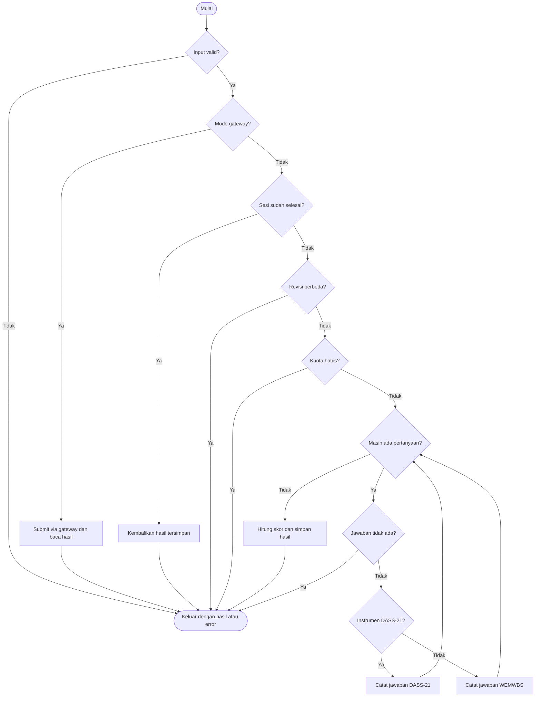

# Pengujian white-box WellBeing Hub

Pengujian dilakukan pada 28 November 2026 di branch `test/whitebox-vitest`, dengan kode aplikasi dari commit `02b2b7a`. Vitest dan V8 menguji TypeScript melalui unit test dan integration test. PGlite menjalankan tes constraint dan transaksi PostgreSQL secara terisolasi. Jalur Supabase dan worker dalam tes unit menggunakan mock serta data sintetis.

## Hasil pengujian

| Putaran | File lulus | Tes lulus | Tes gagal |
|---|---:|---:|---:|
| Regresi awal | 46/48 | 636 | 6 |
| Setelah tes diselaraskan dengan kontrak saat ini | 48/48 | 640 | 0 |
| Setelah tes cabang prioritas ditambahkan | 49/49 | 662 | 0 |

Lima kegagalan awal berasal dari ekspektasi terhadap pengecekan registrasi dengan Prisma yang sudah dihapus. Satu kegagalan berasal dari ekspektasi `DIRECT_URL` pada template runtime. Tes yang diperbarui mengikuti respons Supabase Auth dan konfigurasi runtime saat ini. Tes PGlite tetap memverifikasi rollback pembuatan akun ketika NIM/NIP duplikat.

| Modul | Cabang dijalankan | Cabang terdeteksi | Branch coverage |
|---|---:|---:|---:|
| Registrasi, login, dan hak akses | 123 | 145 | 84,83% |
| Asesmen dan scoring | 210 | 222 | 94,59% |
| Laporan PDF | 254 | 313 | 81,15% |
| Jadwal, booking, dan persetujuan akses | 296 | 363 | 81,54% |
| Konsultasi dan chat | 237 | 266 | 89,10% |
| Super Admin | 107 | 123 | 86,99% |
| **Total** | **1.227** | **1.432** | **85,68%** |

V8 mengukur 81 file layanan dan route TypeScript dalam cakupan. *Line coverage* mencapai **85,44%** dan *function coverage* **88,93%**. Pengukuran awal setelah penyelarasan suite mencatat 1.178 dari 1.366 cabang. Tes tambahan menjalankan 49 cabang lagi, sekaligus membuat V8 mendeteksi 66 cabang tambahan pada fungsi yang baru dijalankan. Perubahan jumlah cabang terdeteksi membuat persentase turun dari 86,23% ke 85,68%.

| Area | Hasil yang diverifikasi |
|---|---|
| Auth | Permintaan lintas origin dan akun belum terkonfirmasi ditolak. Respons registrasi tetap netral untuk email yang sudah terdaftar. Trigger database membatalkan pembuatan identitas untuk NIM/NIP duplikat. |
| Asesmen | Batas skor, kuota, revisi, kepemilikan, jawaban tidak lengkap, dan pengembalian hasil saat submit diulang lulus. Tes gateway memeriksa identitas sebelum query dan membaca hasil tersimpan. |
| PDF | Status `PENDING` tidak diterima sebagai generate berhasil. Ukuran dan hash file diverifikasi sebelum akses dicatat. Pencabutan izin selama pembacaan membuat unduhan ditolak. |
| Booking | Slot ganda ditolak di database. Kegagalan transaksi membatalkan penulisan appointment, konsultasi, dan consent. Gateway menolak booking tanpa persetujuan serta jam di luar slot Jakarta. |
| Konsultasi | Start ditolak ketika check-in belum lengkap. Gateway menunggu konfirmasi commit sebelum menyatakan pesan berhasil dan menolak pembacaan pada batas akhir sesi. |
| Super Admin | Pembatasan peran dan validasi filter lulus. Route monitoring hanya mengembalikan data operasional yang ditentukan. |

## Basis path `submitAssessment`

Graf mengikuti keputusan eksplisit dalam [fungsi `submitAssessment`](../src/lib/assessment/service.ts#L143) dan callback transaksinya. Operasi gateway SQL, validasi helper, dan kegagalan I/O dikelompokkan sebagai operasi dalam node. Cabang dalam implementasi helper di luar fungsi dianalisis oleh tes tersendiri.



Graf memiliki **15 simpul**, **22 sisi**, dan **1 komponen terhubung**. Kompleksitas siklomatisnya adalah **V(G) = E − N + 2P = 22 − 15 + 2(1) = 9**. Perhitungan berdasarkan delapan keputusan menghasilkan nilai yang sama. Matriks frekuensi sisi untuk sembilan jalur di bawah memiliki rank 9.

| Jalur | Kondisi pada kasus uji | Hasil teramati |
|---|---|---|
| P1 | Revisi tidak dikirim | `VALIDATION_ERROR`. Transaksi tidak dimulai. |
| P2 | Mode gateway dengan peserta yang sesuai | Identitas diperiksa, gateway dipanggil dengan revisi, dan hasil tersimpan dikembalikan tanpa penulisan skor langsung. |
| P3 | Submit diulang setelah sesi selesai | Hasil sebelumnya dikembalikan. Skor dan laporan masing-masing dibuat sekali. |
| P4 | Revisi jawaban lama | `STALE_REVISION`. Pengecekan kuota dan penulisan hasil tidak berjalan. |
| P5 | Kuota sudah habis | `ASSESSMENT_QUOTA_EXCEEDED`. Skor tidak ditulis. |
| P6 | Jawaban urutan 1 hilang | `ASSESSMENT_INCOMPLETE` pada pemeriksaan pertama. Skor dan laporan tidak ditulis. |
| P7 | Jawaban urutan 2 hilang | Satu jawaban DASS-21 diproses sebelum `ASSESSMENT_INCOMPLETE`. Skor dan laporan tidak ditulis. |
| P8 | Jawaban urutan 23 hilang | Jawaban DASS-21 dan jawaban WEMWBS pertama diproses sebelum `ASSESSMENT_INCOMPLETE`. Skor dan laporan tidak ditulis. |
| P9 | Semua 35 jawaban lengkap | Kedua instrumen dinilai, metadata laporan dibuat dengan status `PENDING`, dan asesmen selesai dalam satu transaksi. |

Semua kasus pada tabel lulus di [suite layanan asesmen](../tests/assessment-service.test.ts). Suite yang sama juga menguji penolakan aktor yang keliru sebelum query, metadata hasil yang tidak lengkap, dan kegagalan ketika membuat laporan. [Tes database asesmen](../tests/assessment-database.test.ts) memverifikasi rollback penulisan skor di PostgreSQL terisolasi.

## Reproduksi dan batas bukti

```powershell
npm.cmd test
npm.cmd run test:coverage
```

Laporan HTML dapat dibuka di `coverage/index.html`. Angka per file tersedia di `coverage/coverage-summary.json`. Log awal dan akhir pelaksanaan ini tersimpan di `.tmp/whitebox-vitest/baseline.log`, `.tmp/whitebox-vitest/regression.log`, dan `.tmp/whitebox-vitest/coverage.log`.

Persentase cakupan berasal dari file TypeScript terpilih. Bukti constraint dan rollback SQL dicatat melalui hasil tes PGlite. Proses server worker dan sejumlah adapter runtime masih memiliki cabang yang belum teruji. Pengujian ini dilakukan lokal dan tidak menjalankan acceptance browser atau layanan hosted.
